<p align="center">
  
</p>

<p align="center">
  
  
  
  
  
  
</p>

<p align="center">
  Which departments, triage levels and time slots drive long outpatient waits, and can we predict a new patient's wait?<br>
  An end-to-end analysis of <b>5,000 OPD visits</b>: cleaning, SQL, EDA, ML modelling and a 3-page Power BI dashboard.
</p>

<p align="center">
  <a href="#key-insights">Key insights</a> ·
  <a href="#recommendations-hypotheses-to-test">Recommendations</a> ·
  <a href="#power-bi-dashboard">Dashboard</a> ·
  <a href="#workflow">Workflow</a> ·
  <a href="#wait-time-prediction">Prediction model</a> ·
  <a href="#sql-analysis">SQL</a> ·
  <a href="#getting-started">Getting started</a> ·
  <a href="#limitations">Limitations</a>
</p>

---

<p align="center">
  
</p>

> [!NOTE]
> **TL;DR:** Triage level decides almost everything about an OPD wait (5 min for Immediate vs 75 min for Non-urgent). Neurology and Internal Medicine are the slowest departments. A Random Forest predicts the wait to within ±27 min on average, mostly by learning the triage effect.

> [!WARNING]
> The public dataset looks **synthetic** (near-uniform volumes, flat hourly patterns). Read this project as a demonstration of the full analytics workflow, not as findings about a real hospital.

<table align="center">
  <tr>
    <td align="center">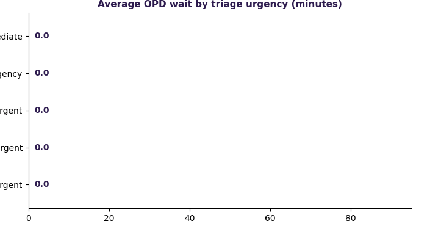</td>
    <td align="center">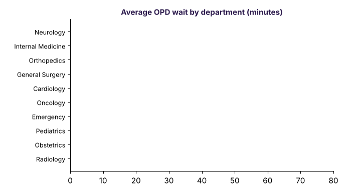</td>
  </tr>
</table>

## Problem Statement

Long and unpredictable outpatient (OPD) waiting times are a common pain point in hospitals. This project analyses patient-visit records to find operational bottlenecks (busy departments, peak slots, staffing impact) and builds a machine-learning model that estimates the expected wait for a new patient, as a planning aid for hospital staff.

**Target metric:** `WaitTimeMinutes`, the time from triage completion to the start of the doctor's consultation (derived from `TriageToProviderStartTime`).

## Workflow

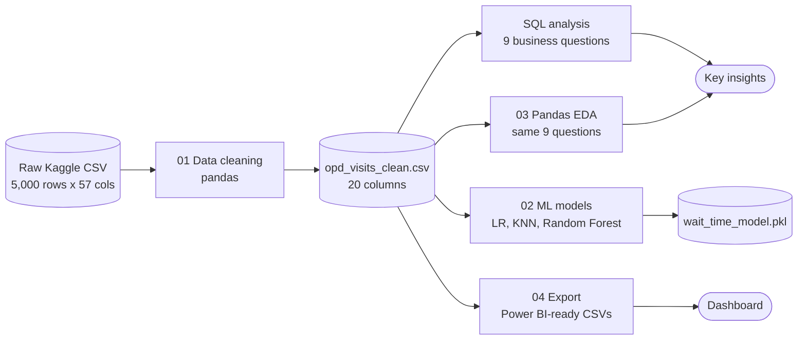

| Step | Notebook / file | What it does |
|---|---|---|
| 1. Clean | [`01_data_cleaning.ipynb`](notebooks/01_data_cleaning.ipynb) | Select 20 relevant columns, drop duplicates and invalid waits, parse dates, export clean CSV |
| 2. Analyse (SQL) | [`analysis_queries.sql`](sql/analysis_queries.sql) | 9 business questions: department, hour, weekday, triage, staffing, weekend |
| 3. Analyse (pandas) | [`03_pandas_analysis.ipynb`](notebooks/03_pandas_analysis.ipynb) | Same 9 questions with `groupby`, plus charts |
| 4. Predict | [`02_wait_time_prediction.ipynb`](notebooks/02_wait_time_prediction.ipynb) | Linear Regression vs KNN vs Random Forest (GridSearchCV tuned) |
| 5. Export | [`04_export_for_powerbi.ipynb`](notebooks/04_export_for_powerbi.ipynb) | Pre-aggregated tables for Power BI in [`dashboard/powerbi_data/`](dashboard/powerbi_data) |
| 6. Visualise | Power BI Desktop | 3-page dashboard: overview, heatmap and volume, model performance |

## Dataset

Public Kaggle dataset [*Hospital Wait Time Data*](https://www.kaggle.com/datasets/bharathreddybollu/hospital-wait-time-data) (5,000 visits, 57 columns, Jan to Mar 2024).
The raw file is not redistributed; see [`data/raw/README.md`](data/raw/README.md). The cleaned data is in [`data/processed/`](data/processed).

**Cleaning summary:** all 5,000 rows were retained (no duplicates or invalid waits found) and 57 columns were reduced to the 20 relevant ones.

<details>
<summary><b>Data dictionary (20 columns in the cleaned file)</b></summary>

| Group | Columns |
|---|---|
| Patient | `PatientID`, `AgeGroup`, `InsuranceType`, `ArrivalMethod` |
| Visit | `Department`, `AppointmentType`, `TriageCategory` |
| Time | `VisitDate`, `ArrivalHour`, `DayOfWeek`, `IsWeekend`, `Month`, `Quarter` |
| Capacity | `FacilityOccupancyRate`, `ProvidersOnShift`, `NursesOnShift`, `StaffToPatientRatio` |
| Outcomes | **`WaitTimeMinutes` (target)**, `TotalTimeInHospital`, `TotalDelayTime` |

Column meanings are inferred from names in the source dataset; check the Kaggle description for exact definitions.

</details>

## Key Insights

<p align="center">
  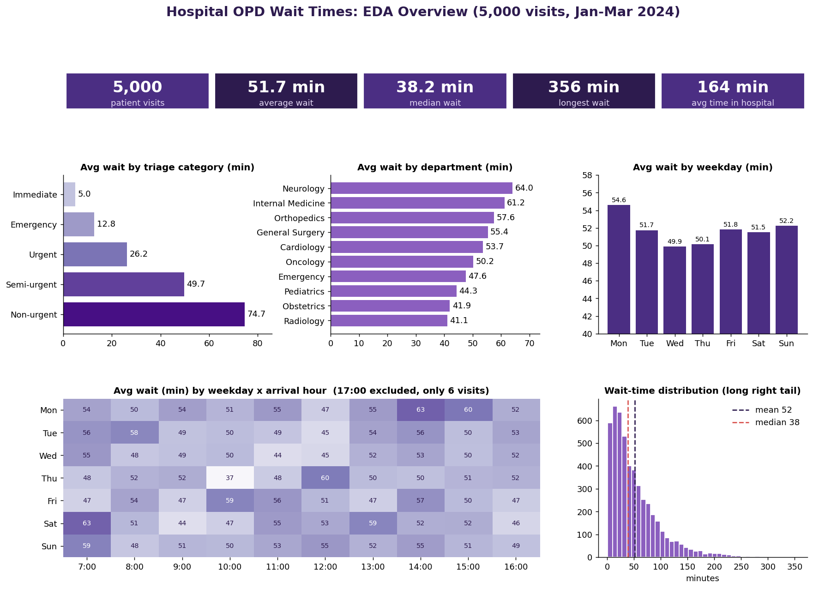
</p>

1. **Triage works as intended, and it dominates waiting time.** Average wait rises from **5.0 min (Immediate)** and 12.8 (Emergency) to 26.2 (Urgent), 49.7 (Semi-urgent) and **74.7 min (Non-urgent)**. Triage category carries **83%** of the Random Forest's feature importance.
2. **Neurology (64.0 min) and Internal Medicine (61.2 min) are the slowest departments**; Radiology (41.1) and Obstetrics (41.9) are the fastest, a gap of about 23 minutes.
3. **Waits are long-tailed:** median 38.2 min vs mean 51.7 min, with a longest wait of 355.8 min, so averages understate the worst experiences.
4. **No meaningful effect from weekend vs weekday (51.9 vs 51.7), age group (50.9 to 52.3), facility occupancy or staffing levels** (correlation with wait is about 0.01 to 0.02). Monday is the busiest weekday (54.6 min), Wednesday the quietest (49.9 min).
5. The 17:00 slot shows a 147.9 min average but has only **6 visits**, so it is noise, not a trend (it also appears as the red outliers in the dashboard heatmap).

### Patient mix by triage level

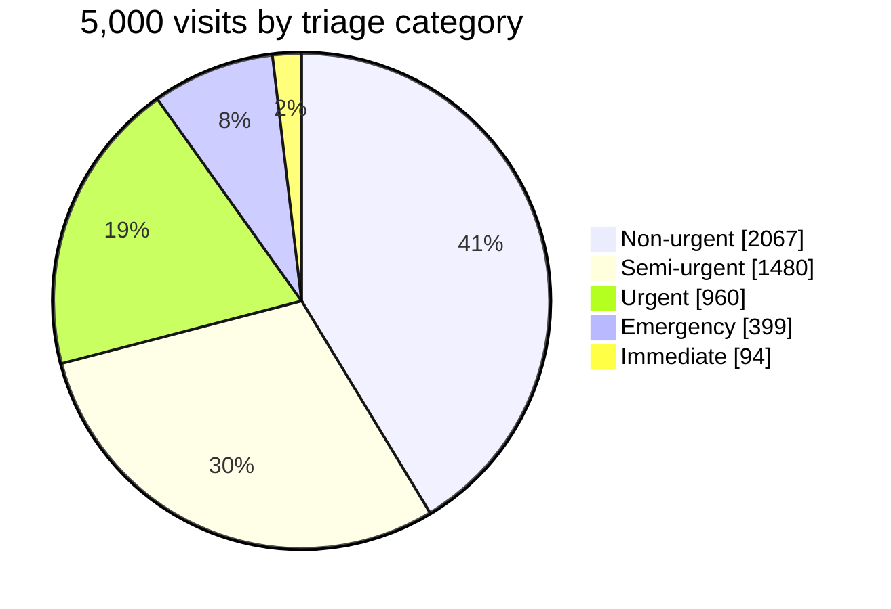

### Recommendations (hypotheses to test)

| Observation | Suggested action |
|---|---|
| Non-urgent patients are **41.3% of visits but 59.7% of all waiting minutes** | Fast-track clinic or appointment slotting for low-acuity cases |
| Neurology and Internal Medicine average **62.6 min** vs about 41.5 in Radiology / Obstetrics | Review clinic scheduling and doctor allocation in those two departments |
| **8.5% of visits wait over 2 h** (p90 = 111.6 min, p95 = 143.7 min, 31.7% wait over 60 min) | Escalation alert when a patient passes about 90 min |
| Staffing and occupancy show almost no correlation with wait (≈0.01 to 0.02) | Collect real shift-level data before drawing staffing conclusions |

## Power BI Dashboard

<p align="center">
  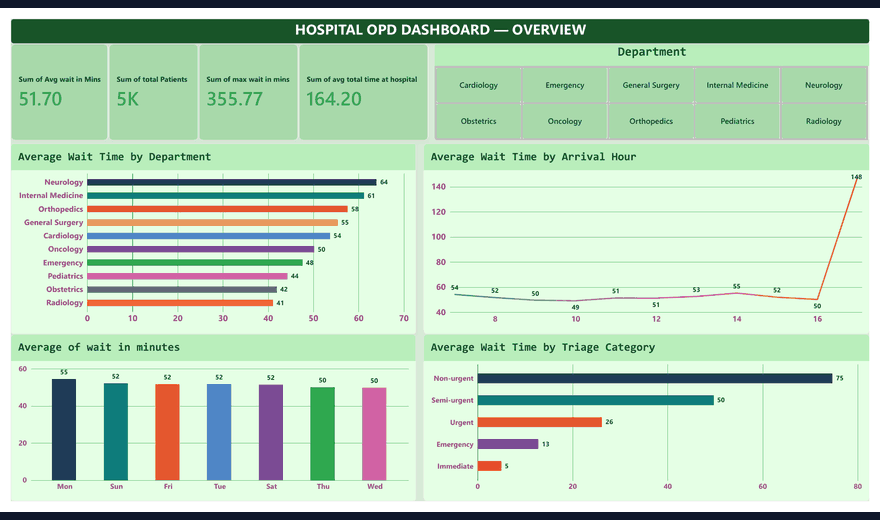
</p>

Three-page interactive dashboard built in Power BI Desktop from the exports in [`dashboard/powerbi_data/`](dashboard/powerbi_data), with a department slicer on the overview page.

<details>
<summary><b>Full-resolution pages</b></summary>
<br>

**1. Overview:** KPI cards, wait by department, arrival hour, weekday and triage category
<p align="center">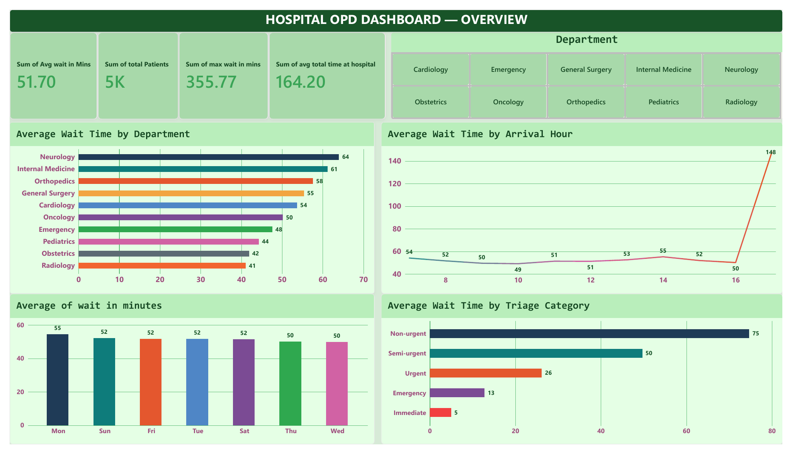</p>

**2. Heatmap and volume:** weekday x hour heatmap, age-group mix, department-wise volume vs wait
<p align="center">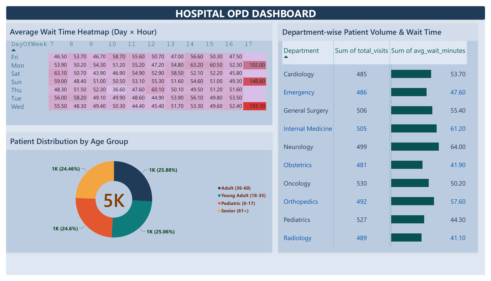</p>

**3. Model performance:** MAE and R² comparison, Random Forest highlighted as the winner
<p align="center">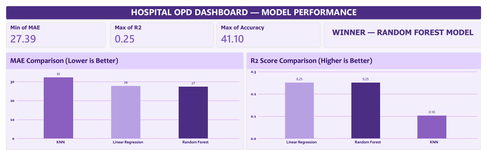</p>

</details>

## Wait-Time Prediction

Three regression models predict `WaitTimeMinutes` from department, weekday, triage category, appointment type, arrival hour, weekend flag, occupancy and staffing (80/20 split, `random_state=42`).

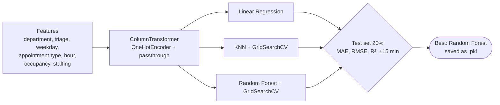

<p align="center">
  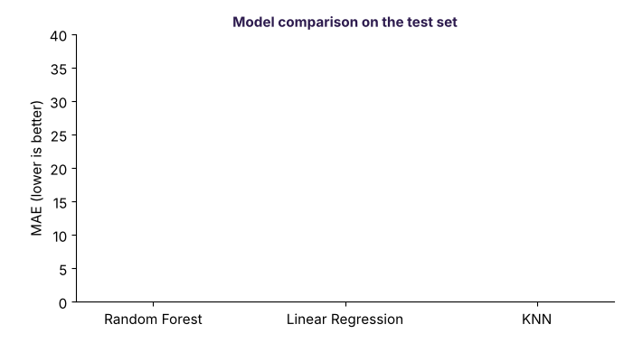
</p>

| Model | MAE (min) | RMSE (min) | R² | Within ±15 min |
|---|---|---|---|---|
| **Random Forest** (tuned) | **27.39** | 40.16 | 0.251 | **41.1%** |
| Linear Regression | 27.75 | 40.17 | 0.251 | 40.1% |
| KNN (tuned) | 32.24 | 43.94 | 0.103 | 25.7% |

<p align="center">
  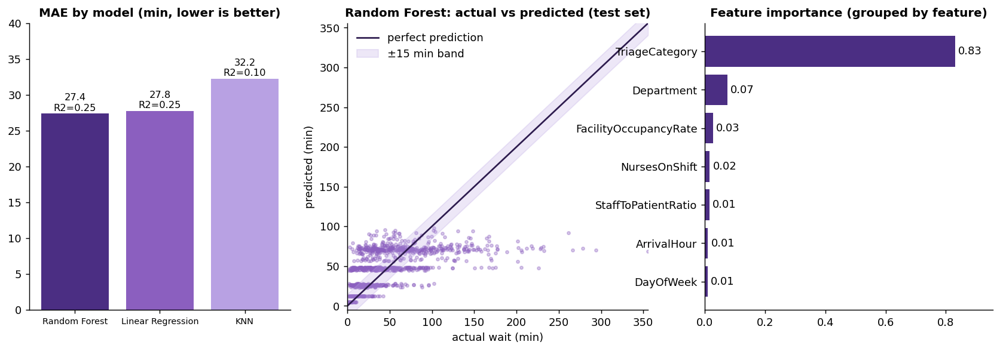
</p>

**Takeaway:** the model explains about a quarter of the variance. The scatter plot shows predictions clustering in horizontal bands, one per triage level, so the model is effectively a **triage-based estimate**. Random Forest only marginally beats the linear baseline, which suggests the remaining features carry little extra signal in this dataset. KNN struggles because distance over many one-hot categorical features is not meaningful.

<details>
<summary><b>Actual vs predicted for a random sample of 60 test patients</b></summary>
<br>
<p align="center">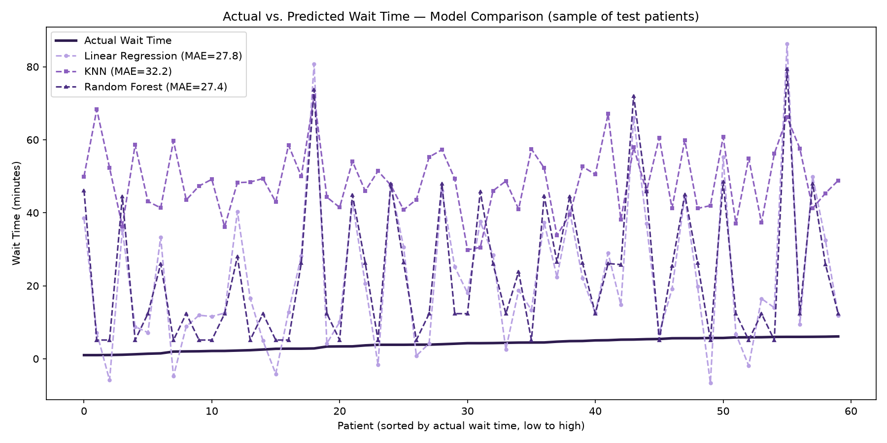</p>
</details>

## SQL Analysis

Nine queries in [`sql/analysis_queries.sql`](sql/analysis_queries.sql) (MySQL / SQLite compatible), run on a table `opd_visits` loaded from the cleaned CSV:

1. Average wait by department · 2. Wait by arrival hour · 3. Wait by weekday · 4. Top 10 longest waits · 5. Worst department + hour combinations · 6. Wait by triage category · 7. Staffing impact · 8. Weekend vs weekday · 9. Overall KPI summary

<details>
<summary><b>Example: are urgent cases really seen faster?</b></summary>

```sql
SELECT TriageCategory,
       ROUND(AVG(WaitTimeMinutes), 1) AS avg_wait_minutes,
       COUNT(*) AS total_visits
FROM opd_visits
GROUP BY TriageCategory
ORDER BY avg_wait_minutes DESC;
```

| TriageCategory | avg_wait_minutes | total_visits |
|---|---|---|
| Non-urgent | 74.7 | 2,067 |
| Semi-urgent | 49.7 | 1,480 |
| Urgent | 26.2 | 960 |
| Emergency | 12.8 | 399 |
| Immediate | 5.0 | 94 |

</details>

## Project Structure

```
hospital-opd-wait-time-analysis/
├── README.md
├── LICENSE
├── requirements.txt
├── assets/                  # banner, KPI strip
├── data/
│   ├── raw/                 # place Kaggle CSV here (not committed)
│   └── processed/           # opd_visits_clean.csv
├── sql/                     # analysis_queries.sql
├── notebooks/               # 01 cleaning · 02 model · 03 pandas EDA · 04 export
├── models/                  # wait_time_model.pkl
├── dashboard/powerbi_data/  # Power BI-ready summary tables
└── reports/
    ├── dashboard/           # Power BI dashboard pages
    └── screenshots/         # GIFs, EDA and model charts
```

## Getting Started

```bash
git clone https://github.com/ALI-ASIF-GIT/hospital-opd-wait-time-analysis.git
cd hospital-opd-wait-time-analysis
python -m venv venv && venv\Scripts\activate      # Windows (use source venv/bin/activate on macOS/Linux)
pip install -r requirements.txt
```

1. Download the dataset into `data/raw/` (see [`data/raw/README.md`](data/raw/README.md)).
2. Run the notebooks in order: `01` → `02` → `03` → `04`.
3. Load `data/processed/opd_visits_clean.csv` as table `opd_visits` and run `sql/analysis_queries.sql`.

Using the saved model:

```python
import joblib, pandas as pd

model = joblib.load("models/wait_time_model.pkl")
patient = pd.DataFrame([{
    "Department": "Neurology", "DayOfWeek": "Mon", "TriageCategory": "Semi-urgent",
    "AppointmentType": "New Patient", "ArrivalHour": 10, "IsWeekend": 0,
    "FacilityOccupancyRate": 0.8, "ProvidersOnShift": 6, "NursesOnShift": 12, "StaffToPatientRatio": 0.4,
}])
print(model.predict(patient))   # expected wait in minutes
```

## Limitations

- **Public dataset, likely synthetic:** near-uniform department volumes (481 to 530 visits each) and flat hourly / weekday patterns suggest generated data. Treat the findings as a demonstration of the method; they need validation on real hospital data.
- **Limited predictive signal:** R² of 0.25, and the model mostly reflects triage category.
- Only three months of data and a random (not time-based) train/test split.
- The 17:00 arrival slot has too few visits (6) for conclusions.

## Future Work

- [ ] Publish the dashboard to Power BI Service and share the `.pbix` file
- [ ] Validate on real hospital queue data, with time-based train/test split
- [ ] Add queueing-theory features (arrival rate, service rate) and gradient boosting
- [ ] Serve the model through a small Streamlit app for front-desk staff

## Skills Demonstrated

| Area | Where |
|---|---|
| Data cleaning and feature selection (pandas) | `01_data_cleaning.ipynb` |
| SQL aggregation and business questions | `sql/analysis_queries.sql` |
| EDA and storytelling with charts | `03_pandas_analysis.ipynb`, insights above |
| ML pipelines, tuning and honest evaluation (scikit-learn) | `02_wait_time_prediction.ipynb` |
| BI dashboard design (Power BI) | `reports/dashboard/` |

## Author

**Asif Ali** | Junior Assistant, HIS IT at HIMSR & HAHC Hospital
Built as a personal project alongside my work in hospital data systems. It uses a **public Kaggle dataset**, not data from my employer.
[LinkedIn](https://linkedin.com/in/asif-ali-083202208) · [GitHub](https://github.com/ALI-ASIF-GIT)

## License

MIT, see [LICENSE](LICENSE).
